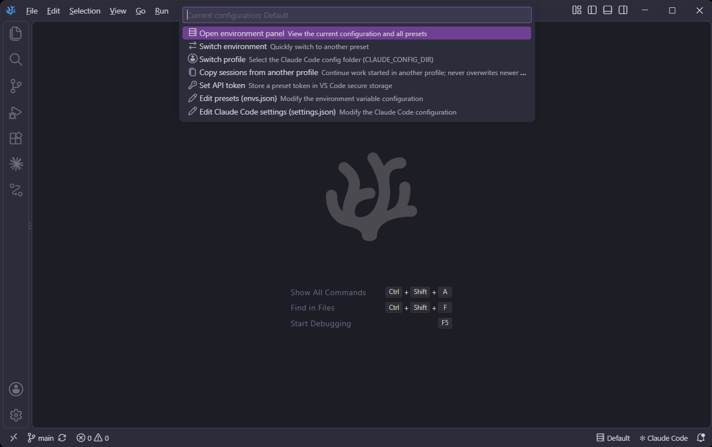
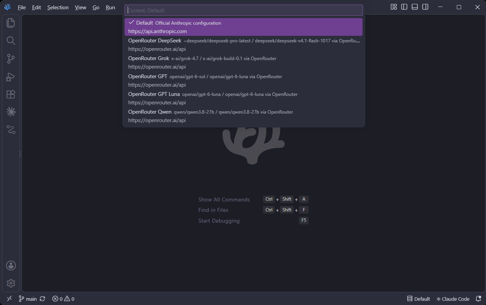
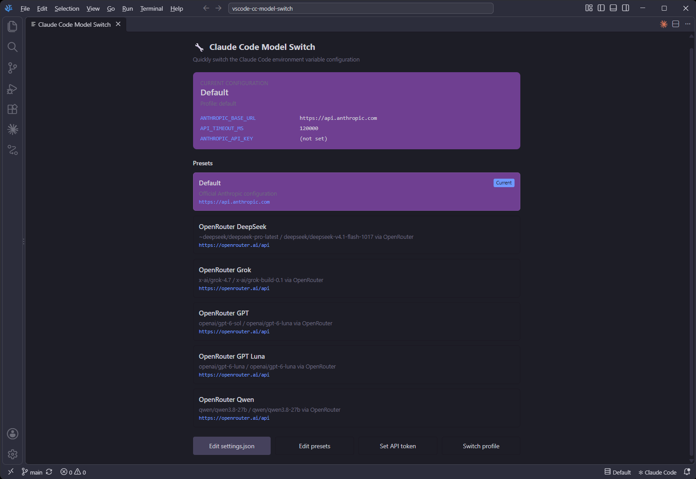

# Claude Code Model Switch

> Switch the Claude Code extension between Anthropic-compatible API providers, models and profiles from the status bar

A VS Code / VSCodium extension that writes the selected provider preset (base URL, models, API token) into the `claudeCode.environmentVariables` setting of the Claude Code extension. The Claude Code CLI in your terminal and its `~/.claude/settings.json` are left alone.

- **Extension ID:** `mikrop.vscode-cc-model-switch`
- **Repository:** <https://github.com/mikrop/vscode-cc-model-switch>
- **Requires:** the Claude Code extension (`anthropic.claude-code`)

## Features

- 🔄 **Quick switching** - switch the provider preset in one click from the status bar
- 👤 **Profiles** - switch the Claude Code config folder (`~/.claude`, `~/.claude-work`, ...)
- 🔑 **Secure tokens** - API tokens are kept in VS Code SecretStorage (OS keychain), not in preset files; presets can share one token
- 📝 **Visual panel** - shows the current configuration and all presets
- 🌐 **Status bar indicator** - always shows the preset and profile in use
- 🔧 **Custom presets** - add any Anthropic-compatible provider in `envs.json`
- 📋 **Session copy** - continue work started in another profile; a session with more work is never overwritten
- 🖥️ **Editor only** - terminal sessions and their own provider setup are not affected

## Screenshots

Click the status bar item for the quick actions:



Switch the provider preset:



The panel shows the current configuration and all presets:



## Bundled presets

| Preset | Base URL | Token |
|--------|----------|-------|
| Default (Anthropic) | `https://api.anthropic.com` | not needed (Claude login) |
| OpenRouter DeepSeek / Grok / GPT / GPT Luna / Qwen | `https://openrouter.ai/api` | required, shared by all OpenRouter presets |

## Installation

The extension is published on [Open VSX](https://open-vsx.org/extension/mikrop/vscode-cc-model-switch), not on the Visual Studio Marketplace.

**VSCodium:** open the Extensions view and search for `Claude Code Model Switch`, or run:

```bash
codium --install-extension mikrop.vscode-cc-model-switch
```

An extension installed this way is updated from Open VSX (use **Extensions: Check for Extension Updates**).

**VS Code:** it uses the Visual Studio Marketplace, so download the `.vsix` from the [Open VSX page](https://open-vsx.org/extension/mikrop/vscode-cc-model-switch) and install it. Such an installation is not updated automatically:

```bash
code --install-extension vscode-cc-model-switch-0.3.1.vsix
```

**From source:** build and install the package locally:

```bash
npm ci
npx @vscode/vsce package
code --install-extension vscode-cc-model-switch-0.3.1.vsix     # VS Code
codium --install-extension vscode-cc-model-switch-0.3.1.vsix   # VSCodium
```

## Usage

1. Click the status bar item on the right (e.g. `$(server) Default`) and pick an action:
   - Open environment panel
   - Switch environment
   - Switch profile
   - Set API token
   - Edit presets (envs.json)
   - Edit Claude Code settings (settings.json)
2. Set the API token for each provider once with **Set API token** (once for all OpenRouter presets).
3. Switch presets; the selected preset is written into the `claudeCode.environmentVariables` user setting.
4. Start a new Claude Code session so it picks up the new environment.

### Commands

All commands are in the **CCModelSwitch** category of the command palette (`Ctrl+Shift+P`).

| Command | ID | Description |
|---------|----|-------------|
| Switch Claude Code Environment | `ccModelSwitch.selectEnv` | Pick and switch the preset |
| Switch Claude Code Profile | `ccModelSwitch.selectProfile` | Pick the Claude Code config folder |
| Open Environment Panel | `ccModelSwitch.showConfig` | View all presets and the current configuration |
| Copy Sessions From Another Profile | `ccModelSwitch.copySessions` | Copy sessions of the open workspace from another profile into the active one |
| Set API Token | `ccModelSwitch.setToken` | Store or remove the API token of a preset |
| Edit settings.json | `ccModelSwitch.editSettings` | Edit the Claude Code settings of the active profile |
| Edit Environment Presets | `ccModelSwitch.editEnvs` | Edit the presets file |

## Configuration

### Where things are stored

| Location | Purpose |
|----------|---------|
| `claudeCode.environmentVariables` (user settings) | Written on every switch. Read by the Claude Code extension when it starts Claude. |
| `~/.claude/envs.json` | Presets. Created with the bundled presets on first start. |
| VS Code SecretStorage | API tokens of all presets. |
| `<profile>/settings.json` | Claude Code settings. Only read, to warn about conflicting variables. |

### What switching does

- Variables defined by any preset (and the ones written by the previous switch) are removed from the setting.
- The credential variables `ANTHROPIC_AUTH_TOKEN` and `ANTHROPIC_API_KEY` (and any custom `tokenEnvKey`) are always removed, so a key for one provider is never sent to another.
- Other entries of the setting are kept unchanged and in order.
- The preset variables and the stored token (under the preset's `tokenEnvKey`) are added.
- A credential variable set to `""` in the preset is written as empty, e.g. `ANTHROPIC_API_KEY` for OpenRouter, so a key from the system environment is not used.
- If the setting is not available (Claude Code extension missing) or is not a list, nothing is written and an error is shown.

> **Note:** Variables in the `env` section of the profile's `settings.json` override the setting. The extension warns after a switch when the `env` section defines one of the switched variables; remove it there.

> **Note:** A top-level `"model"` in `settings.json` is not changed by switching. If it holds a full Claude model ID, providers that do not set `ANTHROPIC_MODEL` will receive a model name they do not know. Prefer aliases (`sonnet`, `opus`, `haiku`) or remove it.

> **Note:** The token of the **active** preset is present in plain text in the VS Code user `settings.json`. Tokens of the other presets stay only in SecretStorage.

### Profiles

**Switch profile** lists `~/.claude` (default) and every `~/.claude-<name>` folder. Selecting a profile sets `CLAUDE_CONFIG_DIR` in the setting (the default profile removes it). Profiles and presets are independent; switching a preset keeps the profile.

### Copying sessions between profiles

Every profile keeps its own conversation history, so `claude --continue` / `--resume` in one profile does not see the work done in another. **Copy Sessions From Another Profile** copies chosen sessions of the open workspace from another profile into the active one. It is always a manual choice, nothing is copied automatically.

Each session is compared with the copy in the active profile by **content**, not by modification time (a copy gets a new time, and a file can be touched without new work). A session only grows, so the one that contains the other is the newer one:

| Active profile has | Result |
|--------------------|--------|
| no such session | copied |
| the same content | skipped |
| the beginning of the source | updated after confirmation, the old file is kept as `<id>.jsonl.bak` |
| **more than the source** | **never overwritten**, the list says so |
| content that differs from the source | replaced only after an explicit confirmation, the old file is kept as `<id>.jsonl.bak` |

> **Note:** Sessions are stored in an internal Claude Code format (`<profile>/projects/<project>/<id>.jsonl`) that may change. Copies develop independently afterwards. A session contains the whole conversation including tool output, so copying it from a personal to a work profile moves that data to the other account. Do not copy a session that is still running.

### envs.json format

```json
{
  "presets": [
    {
      "id": "openrouter-deepseek",
      "label": "OpenRouter DeepSeek",
      "description": "DeepSeek via OpenRouter",
      "requiresToken": true,
      "tokenEnvKey": "ANTHROPIC_AUTH_TOKEN",
      "tokenId": "openrouter",
      "env": {
        "ANTHROPIC_BASE_URL": "https://openrouter.ai/api",
        "ANTHROPIC_API_KEY": "",
        "ANTHROPIC_DEFAULT_OPUS_MODEL": "~deepseek/deepseek-pro-latest",
        "ANTHROPIC_DEFAULT_SONNET_MODEL": "~deepseek/deepseek-pro-latest",
        "ANTHROPIC_DEFAULT_HAIKU_MODEL": "deepseek/deepseek-v4.1-flash-1017",
        "CLAUDE_CODE_SUBAGENT_MODEL": "deepseek/deepseek-v4.1-flash-1017"
      }
    }
  ]
}
```

| Field | Description |
|-------|-------------|
| `id` | Unique identifier. |
| `label` | Name shown in the UI (defaults to `id`). |
| `description` | Optional description. |
| `requiresToken` | Default `true`; set to `false` for presets that work without a token. |
| `tokenEnvKey` | Variable the token is written to. Default `ANTHROPIC_AUTH_TOKEN` (sent as `Authorization: Bearer`); use `ANTHROPIC_API_KEY` (sent as `x-api-key`) for the official Anthropic API. |
| `tokenId` | Name the token is stored under (defaults to `id`). Presets with the same `tokenId` share one token. |
| `env` | Variables written into the setting. Values must be strings (numbers and booleans are converted). `CLAUDE_CONFIG_DIR` is not allowed, use **Switch profile**. |

A token written in `env` under the preset's `tokenEnvKey` still works but is not recommended; a token in SecretStorage takes precedence.

> **Upgrading:** an existing `envs.json` is not rewritten, so it does not contain the OpenRouter presets or the `tokenEnvKey` of the Default preset. Delete `envs.json` to have it recreated with the bundled presets, or copy the presets above into it.

### Environment variables

| Variable | Description |
|----------|-------------|
| `ANTHROPIC_AUTH_TOKEN` | Bearer token for third-party providers (managed via SecretStorage) |
| `ANTHROPIC_API_KEY` | Anthropic API key (managed via SecretStorage) |
| `ANTHROPIC_BASE_URL` | API base URL |
| `API_TIMEOUT_MS` | Request timeout in milliseconds |
| `ANTHROPIC_MODEL` | Model to use |
| `ANTHROPIC_DEFAULT_*_MODEL` | Models for the Haiku / Sonnet / Opus aliases |
| `CLAUDE_CODE_SUBAGENT_MODEL` | Model for subagents |
| `CLAUDE_CONFIG_DIR` | Claude Code config folder (managed by **Switch profile**) |

## Development

```bash
npm ci            # install dependencies
npm run compile   # compile to out/
npm run watch     # compile in watch mode
npm run lint      # lint
npm test          # run tests in a VS Code instance
```

Press F5 in VS Code to start an Extension Development Host.

## License

Apache License 2.0, see [LICENSE](LICENSE).

Based on [vs-cc-switch](https://gitcode.com/TogetherAI/vs-cc-switch) by hepeng (Apache-2.0). Modified: renamed, translated to English, API tokens in SecretStorage, switching via the Claude Code extension setting instead of `settings.json`, profiles.
